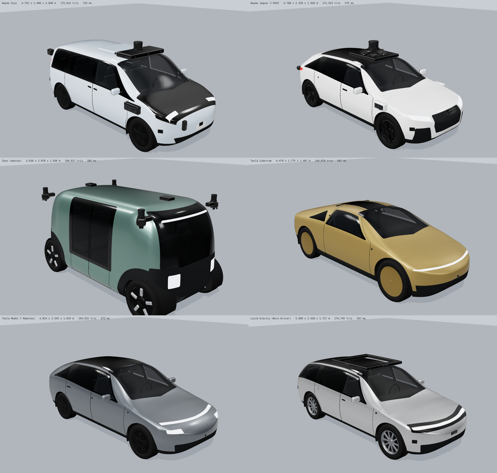
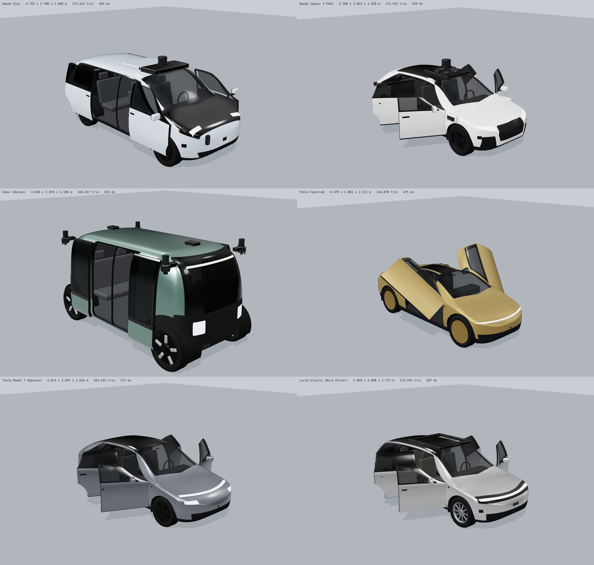
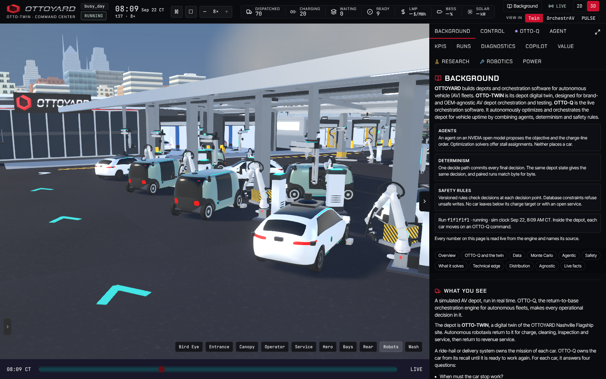
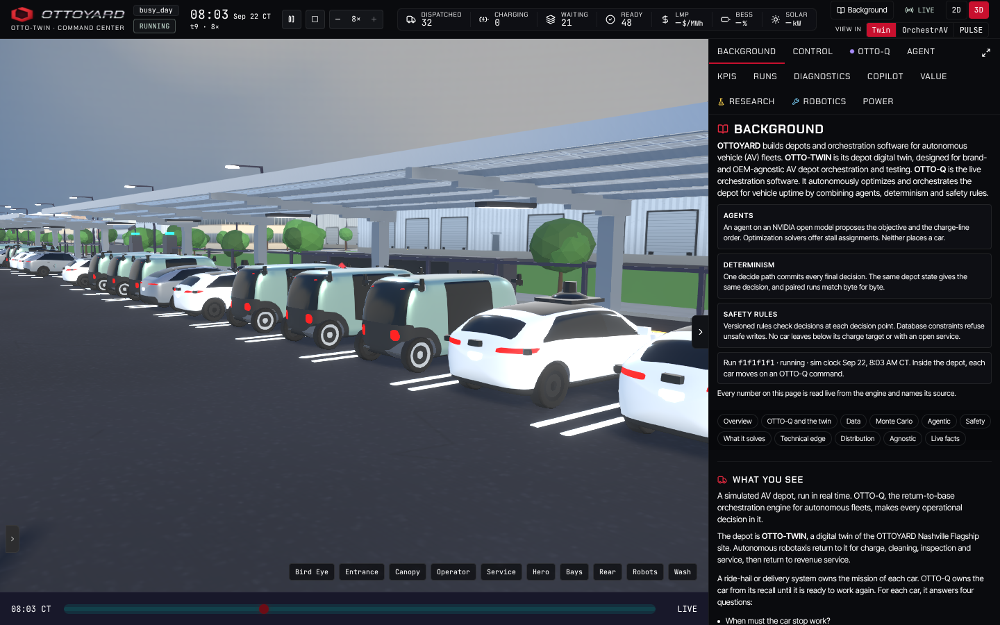

# Fleet vehicle models

Six 3D models of autonomous vehicles that carry riders in the United States in November 2026, built for the twin so
that a depot can show more than one maker's cars. Each has working doors of the right kind, the maker's sensors as
named parts, and a recorded charge port where one is known.

**The 3D yard draws them (2026-11-13), and only draws them.** Each car is drawn as its own model at a light level of
detail (see "In the yard"). Every clearance, following gap and robot reach is still measured against the one generic
car (`traffic.CAR_LENGTH` x `CAR_WIDTH`, `vehicleEnvelope.ts`), and the 2D plan still draws that car. The models
differ in size from it. Giving each vehicle its own envelope is a separate change (see "What comes next").

## What is in the box

| Path | What |
|---|---|
| `src/lib/fleetModels/` | The builder. `buildVehicle(spec)` returns a `THREE.Group`; `setDoors(car, 0..1)` moves the doors. |
| `src/lib/fleetModels/specs/` | One spec per vehicle: dimensions, body curves, door cuts, glass, lamps, sensors, seats. |
| `public/fleet/<key>.glb` | The same models as files (metres, +X nose, +Y up), each with a `doors_open` animation. |
| `public/fleet/manifest.json` | Per vehicle: dimensions, door rigs (pivot, axis, travel), every sensor's type and position, charge port, and what is assumed. |
| `src/lib/fleetModels/yardLod.ts` | `bakeYardModel(spec)`: the light model the yard draws, merged by finish, doors kept apart. |
| `src/lib/fleetModels/assign.ts` | `fleetModelKeyFor(row)`: which model a car of the twin's snapshot is drawn as. |
| `src/components/canvas/three/fleetYard.ts` | The instanced fleet of one model: every car of a model in a fixed number of draw calls. |
| `fleet-check.html` | Dev page: `?model=<key>&view=iso&doors=0..1`, `&glb=1` to load the file instead of building, `&yard=1` for the yard's light model through the yard's own draw path. |
| `scripts/fleetShots.mjs`, `scripts/exportFleetModels.mjs` | Shoot the page; rewrite the GLBs and the manifest. |

Rebuild the files after a spec change (dev server on 8094): `node scripts/exportFleetModels.mjs`.

## How a model is made

A body is one closed surface. Six curves per vehicle (roof line, underside, half-width, beltline, roof rail, roof-rail
half-width) place a ring of control points at every station, and a cubic B-spline through each ring gives the skin.
Glass, doors, wheel arches and lamps are regions of that one surface, cut along a line, so a door's edge and the
opening it leaves are the same curve. Each panel then gets an inner skin and an edge wall, so an open door has
thickness and the cabin has walls.

Node names are the contract: `body`, `door_<FL|FR|RL|RR|L|R>`, `wheel_<FL|FR|RL|RR>`, `sensor_<id>`, `interior`,
`mirror_<L|R>`, `charge_port`.

## The six vehicles

| Key | Vehicle | Operator | L x W x H (m) | Wheelbase | Doors | Sensors drawn |
|---|---|---|---|---|---|---|
| `waymo_ojai` | Waymo Ojai (Zeekr) | Waymo | 4.688 x 1.995 x 1.755 | 3.008 | 4 sliding, no centre pillar: front runs forward, rear runs back | 4 lidar, 13 cameras, 6 radar |
| `waymo_ipace` | Jaguar I-PACE, 5th-generation Driver | Waymo | 4.682 x 1.895 x 1.565 | 2.990 | 4 hinged | 5 lidar, 10 camera positions, 6 radar |
| `zoox_robotaxi` | Zoox robotaxi | Zoox | 3.630 x 1.83 x 1.936 | 2.79 | 4 sliding glass panels, parting from the middle | 4 corner pods |
| `tesla_cybercab` | Tesla Cybercab | Tesla Robotaxi | 4.445 x 1.753 x 1.407 | 2.84 | 2 butterfly | 8 cameras |
| `tesla_model_y` | Tesla Model Y (2025 on) | Tesla Robotaxi | 4.790 x 1.920 x 1.624 | 2.890 | 4 hinged | 8 cameras |
| `lucid_gravity_nuro` | Lucid Gravity, Nuro Driver | Uber | 5.030 x 2.000 x 1.660 | 3.040 | 4 hinged | roof halo, 5 lidar, 11 cameras, 5 radar |

The body of each model measures its stated length, width and height to within 12 mm (`fleetModels.test.ts`).

## What is published and what is not

Every number came from a source read on 2026-11-13. Where no source gives a number, the table says so and the spec's
`provenance` carries the same sentence into the manifest.

| Vehicle | Published | Estimated or assumed |
|---|---|---|
| Waymo Ojai | Doors: "elevator-like doors" [1], "double doors open to the sides instead of swinging out" [2]; no B-pillar [3]. Sensors: "13 cameras, 4 lidar, 6 radar" [4]. | **Dimensions are the related Zeekr Mix's** (4,688 x 1,995 x 1,755 mm, wheelbase 3,008 mm) [5]; Waymo has published none [3]. Door travel. Where each sensor sits (read off photographs [P1]). Charge port side. |
| Jaguar I-PACE | 4,682 x 1,895 x 1,565 mm, wheelbase 2,990 mm [6]. One 360 lidar and four perimeter lidars "at four points around the sides" [7]. | 29 cameras and 6 radars are press figures [8], not on Waymo's page; 10 camera positions are drawn. Where each sensor sits (photographs [P2]). Track, tyres. |
| Zoox | 3,630 mm long, 1,936 mm tall [9]. Bidirectional, four-wheel steering, sliding doors [9]. A sensor pod at each of four corners with about 270 degrees of view each [10]. | **Width about 1.83 m** ("nearly six feet", 2020 press) and **wheelbase 2.79 m** (measured off a photograph [P3]). Sensors per pod. No charge port is published and none is drawn. |
| Tesla Cybercab | Height 55.4 in, width 69.0 in, ground clearance 5.7 in, nine cameras of which eight look outward [11]. Butterfly doors, no mirrors, no rear window [12]. | **Length about 4,445 mm** is a pre-production estimate from a drone photograph, and the same article gives the width as 63 in [13]. **Wheelbase 2.84 m** is measured off a side photograph [P4]. Camera positions follow Tesla's usual layout. |
| Tesla Model Y | 4,790 x 1,920 x 1,624 mm, wheelbase 2,890 mm [14]. | Track, tyres. Camera positions are Tesla's usual layout. |
| Lucid Gravity | 5,030 x 2,000 x 1,660 mm, wheelbase 3,040 mm [15]. Cameras, solid-state lidar and radar "integrated into the vehicle's body and its low-profile, roof-mounted Halo module"; the halo shows rider initials [16][17]. | Sensor counts and positions: neither Nuro nor Lucid has published them [17]. Halo size. |

### Sources

1. Waymo, "Welcoming riders in the Ojai", May 2026. https://blog.waymo.com/blog/2026/05/welcoming-riders-in-the-ojai
2. The San Francisco Standard, 2026-08-30. https://sfstandard.com/2026/08/30/waymo-ojai-blue-vans-here/
3. Wikipedia, "Waymo Ojai" (its dimension fields are empty). https://en.wikipedia.org/wiki/Waymo_Ojai
4. Waymo, "Meet the 6th-generation Waymo Driver", 2024-08-19. https://waymo.com/blog/2024/08/meet-the-6th-generation-waymo-driver
5. Wikipedia, "Zeekr Mix". https://en.wikipedia.org/wiki/Zeekr_Mix
6. Wikipedia, "Jaguar I-Pace". https://en.wikipedia.org/wiki/Jaguar_I-Pace
7. Waymo, "Introducing the 5th-generation Waymo Driver", 2020-03-04. https://waymo.com/blog/2020/03/introducing-5th-generation-waymo-driver
8. CleanTechnica, 2020-03-07 (read as a search summary, not opened). https://cleantechnica.com/2020/03/07/waymo-unveils-its-5th-generation-autonomous-driving-technology/
9. Carscoops, 2020-12 (read as a search summary, not opened). https://www.carscoops.com/2020/12/amazons-zoox-unveils-their-autonomous-robotaxi/
10. Scale, "How Zoox builds autonomous vehicles from the wheels up" (search summary). https://exchange.scale.com/public/blogs/how-zoox-builds-autonomous-vehicles-from-the-wheels-up
11. Not a Tesla App, 2026-09-07. https://www.notateslaapp.com/news/4657/tesla-cybercab-specs-supermanifold-v3-no-rare-earth-magnets-more
12. Wikipedia, "Tesla Cybercab". https://en.wikipedia.org/wiki/Tesla_Cybercab
13. Teslarati, 2026-03-25. https://www.teslarati.com/tesla-cybercab-model-y-size-comparison/
14. Wikipedia, "Tesla Model Y". https://en.wikipedia.org/wiki/Tesla_Model_Y
15. Wikipedia, "Lucid Gravity". https://en.wikipedia.org/wiki/Lucid_Gravity
16. Nuro, robotaxi page. https://www.nuro.ai/nuro-lucid-uber-robotaxi
17. Electrek, 2026-01-05. https://electrek.co/2026/01/05/lucid-uber-nuro-unveil-production-intent-gravity-robotaxi/

Photographs studied, all on Wikimedia Commons: [P1] "Waymo Ojai robotaxi on Mission Street San Francisco 2026 dllu.jpg"
and "Waymo Zeekr Vehicle at Bayshore Depot oblique view dllu.jpg"; [P2] "Waymo Jaguar I-Pace in San Francisco 2023
dllu.jpg"; [P3] "Zoox Autonomous Robotaxi - San Francisco May 2025 (4).jpg"; [P4] "Tesla Cybercab at Santana Row side
view dllu.jpg" and "Tesla_Cybercab_-_San_Francisco_-_June_2026.jpg". No photograph or maker's mark is in the models.

Was the Lucid in public service on 2026-11-13? Not established. Nuro's page says "late 2026"; one tracker says the
launch slipped to early 2027. It is here because Nuro was asked for and this is the only Nuro Driver passenger car.

## In the yard

The same staging row before, every car the generic car: `pr-shots/fleet-yard/staging-before.png`.

**Which model a car is** comes from the twin's snapshot row, in `fleetModelKeyFor`: the row's `port.profile` when it
is one of the six keys, else the first match on the make and model text (`cybercab`, `tesla`, `zeekr|ojai`,
`jaguar|i-pace|waymo`, `zoox`, `lucid|gravity`), else the generic car. The recorded run `fresh0922` has 116 cars:
44 I-PACE, 36 Model Y, 34 Zoox, 2 Ojai. Its rows carry a make and no model, so no car there is a Cybercab or a Gravity.

**The light model** is the same surface and the same cuts on a coarser grid (`buildVehicle(spec, { yard: true })`):
the outer skin alone, plain wheels, box seats, no sensor under 5 cm. `bakeYardModel` merges it by finish. Measured
by `yardLod.test.ts` and `fleetYard.test.ts`:

| Key | Triangles a car | Body draws | Door draws | All draws |
|---|---|---|---|---|
| `waymo_ojai` | 8,666 | 5 | 8 | 15 |
| `waymo_ipace` | 9,016 | 5 | 8 | 15 |
| `zoox_robotaxi` | 8,846 | 5 | 8 | 15 |
| `tesla_cybercab` | 7,340 | 5 | 4 | 11 |
| `tesla_model_y` | 8,367 | 5 | 8 | 15 |
| `lucid_gravity_nuro` | 9,018 | 5 | 8 | 15 |

"All draws" is for every car of that model together: five body finishes (paint, gloss, matte, rim, lamps), a panel
and a window for each door, the status strips and the shadow body. The shadow pass draws one more, a closed body of
572 triangles, in place of the model. The body box is within 3 cm of the full model's. A model is built in the
browser once, in about 0.1 s, and its cars are the generic car until then.

**Measured in the cockpit** (`scripts/perfHarness.mjs`, recorded run `fresh0922`, desktop profile, whole frame with
the shadow and post passes; a software renderer, so frame times are not quoted):

| Camera | Cars on site | Draw calls, generic car | Draw calls, models | Triangles, generic car | Triangles, models |
|---|---|---|---|---|---|
| Bird Eye | 50 | 522 | 566 | 2.68M | 3.02M |
| Operator | 38 | 535 | 579 | 2.62M | 2.88M |
| Canopy | 32 | 500 | 544 | 2.56M | 2.75M |

That run draws four models. The 44 more draw calls do not grow with the number of cars. Triangles do: a model is 7,340 to
9,018 a car plus its 572-triangle shadow body, and the generic car is 2,464 with its body, glass and doors drawn
again in the shadow pass. Measured: 0.34M more triangles a frame with 50 cars on site. Not measured: a frame with
all 116 cars on site, and frame rate on a real GPU or a phone.

A solid paint takes the generic fleet's paint numbers in the yard (`fleetYard.YARD_SOLID`). A white car is still
very bright in the yard's sun, as the generic fleet's white cars are (see the before picture). Metallic and satin
paints keep the spec's.

**What stays the generic car's:** the pose, the charge-port ring (it is where the charge arm mates, on the generic
car's flank, so it stands a few centimetres off a narrower model and inside a wider one), the hover badge and the
owner marks. Doors open by the same door store value, through each model's own rig. Paint is each model's own, so
cars of one model are one colour.

## What these models are, and are not

- They are built from code and published dimensions, not scanned or traced from a maker's CAD. Proportions, door
  kinds and sensor layout are right enough to tell the six apart at a glance and to measure reach against. Surface
  detail (panel creases, lamp internals, wheel designs, grilles) is simplified. They carry no badges.
- About 115,000 to 145,000 triangles each in the files (3 to 5.7 MB). That is a close-up model. The yard draws up to
  116 cars, so it draws the light model above, not these files.

## What the robots will have to deal with

These came out of building the models. None is fixed here.

1. **Sliding doors run along the body.** The Ojai's front door runs 0.66 m forward over the front wing and its rear
   door 0.82 m back; the Zoox's panels run 0.6 m each way. A charge arm or cleaning arm standing abeam the car is in
   that path on some vehicles. Open hinged doors reach 0.97 to 1.05 m outboard of the body side in these models.
2. **The Cybercab's doors go up.** Open, the model's door top stands 2.11 m above the ground and reaches 1.06 m outboard of
   the body side (the swing angle is fitted to one photograph). The overhead cleaning arm and the canopy steel need checking against that.
3. **Charge ports are not in one place.** Left front wing (I-PACE), left rear (Model Y, Gravity), assumed left rear
   quarter (Ojai), and not published for the Zoox. The yard's chargers stand on one flank today.
4. **The Cybercab may have no plug to mate with.** Tesla describes inductive charging under the car as its main
   method and no plug location is published [12]. A charge arm has nothing to reach for until that is known.
5. **Sizes differ by 1.4 m in length and 0.53 m in height.** 3.63 m (Zoox) to 5.03 m (Gravity); 1.41 m (Cybercab) to
   1.94 m (Zoox). The yard's one car is 4.69 x 1.91 m.
6. **Roof equipment adds height.** In these models the Ojai's roof lidar tops out at 2.04 m, the I-PACE's at 1.92 m and the Gravity's halo at 1.73 m. None of the three heights is published.

## What comes next

1. Done 2026-11-13: a light level of detail per vehicle for the yard (7,300 to 9,000 triangles).
2. A per-vehicle envelope in the place `vehicleEnvelope.ts` holds the one car's, so traffic gaps, stall fit and the
   robots' clearance tests read each vehicle's own body.
3. Map each owner in the twin to its vehicles, from the engine's data, not in the renderer. The yard reads the row's
   `model` and `port.profile` when the engine sends them; until then it reads the make.
